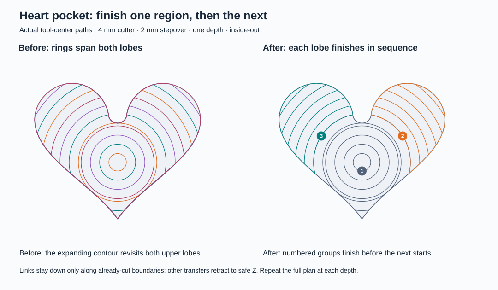

# Pocket region planning

For an irregular concentric pocket, finish each connected region at the current Z depth before moving to another region. Finish all regions before stepping down. On a heart, this completes one upper lobe and then the other instead of alternating between them with every expanding ring.

The illustration uses a 4 mm cutter, 50% stepover, and inside-out ordering. Numbered groups show the machining sequence. Shared central clearing and the bottom tip precede the upper lobes. Outside-in ordering processes the outer regions before the shared center.

Transfers stay down when they can follow an already-cut boundary. Otherwise, the tool retracts to safe Z. Inside-out re-entry starts on a previously cut frontier; outside-in entries retain the selected plunge, ramp, or helix strategy. Both climb and conventional cutting are supported. Rectangle morphing and island-aware plans keep their existing algorithms. If a region boundary cannot be assembled, the engine retains its existing centered/offset-ring fallback.

## Engine revision

This app pins [`StratumCAM` at `80d683e`](https://github.com/alexbartisro/StratumCAM/commit/80d683eeac6e69317b12c894829fb9a53a2a5eeb). The [engine changes](https://github.com/alexbartisro/StratumCAM/compare/4de9fe4...80d683e) contain separate commits for region ordering, extra arc revolutions during loop rotation, complete wall-crossing checks, and a stale radius assertion.

Xcode downloads the pinned package automatically. To work on the engine locally, clone that fork, check out `80d683e`, and use Xcode's local package override. Run `swift test` from the engine checkout. The regression suite checks lobe/arm order, wall and interior coverage, both ring orders and cutting directions, safe-Z transfers, and plunge/ramp/helix entries over multiple depths.
